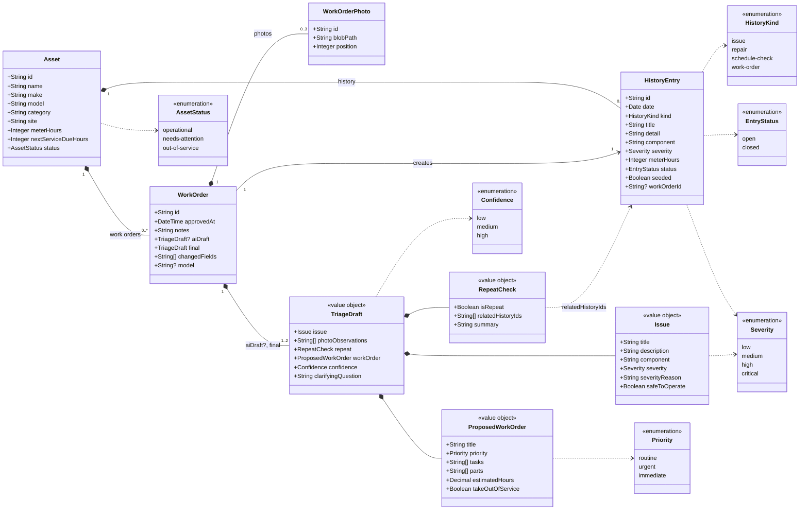

# Data Model — UML Class Diagram

Status: Draft 2 (11 Nov 2026). Matches [technical plan version 2](technical-plan-v2.md), section 4, with the change milestone 4 needs. [Draft 1](data-model.md) is kept for comparison.

## Changes from draft 1

| Change | Draft 1 | Draft 2 | Why |
|---|---|---|---|
| `WorkOrder.aiDraft` | Always set | Optional (empty for a manual work order) | Milestone 4 lets a person fill in the issue and work order by hand, with no AI draft. It is also the fallback when the AI call fails |
| `WorkOrder.model` | Always set | Optional (empty for a manual work order) | No model produced a manual work order |
| `WorkOrder.changedFields` | Compared with the AI draft | Empty when there is no AI draft | Nothing to compare with |
| `WorkOrder` to `TriageDraft` | Exactly 2 (`aiDraft`, `final`) | 1 or 2 | `final` is always stored; `aiDraft` only when the AI drafted it |
| `HistoryEntry.workOrderId` | Implied by the "creates" link | Stored on the history entry | Shows how the "creates one" link is kept in the database, and lets the history show the work order's photos |
| `WorkOrderPhoto.blobPath` | Path in Vercel Blob | Path in the photo store | Vercel Blob in the deployed app; a local folder stand-in until Blob is enabled on the project |

## Diagram

## How to read it

| Class | Stored as | Purpose |
|---|---|---|
| Asset | Database table `assets` | A piece of plant. Its `id` is also what the QR code contains |
| HistoryEntry | Database table `history_entries` | One past event on an asset: an issue, repair, schedule check or work order |
| WorkOrder | Database table `work_orders` | An approved triage, drafted by the AI or entered by hand. Created only when a reviewer approves |
| WorkOrderPhoto | Database table `work_order_photos`; the image itself is in Vercel Blob | A photo submitted with the defect report |
| TriageDraft and its parts | JSON inside a work order, twice: `aiDraft` and `final` | What the AI proposed and what the reviewer approved |

## Relationships

- An asset owns its history entries and work orders. Removing an asset would remove them.
- A work order has up to 3 photos (R7).
- Approving a work order creates exactly one history entry of kind `work-order`, so it shows on the asset's timeline (R24).
- A work order always holds the approved draft (`final`). When the AI drafted it, it also holds the AI's draft and the model, and comparing the two gives `changedFields` (R22). A work order entered by hand has no AI draft, no model and no changed fields.
- A repeat check refers to existing history entries by ID. The server discards any ID that is not a real entry for that asset, so the AI cannot cite history that does not exist.

## Rules the diagram cannot show

- A triage draft is never stored on its own. Discarding one leaves nothing in the database (R21).
- `seeded` marks demo starting data, so the seed script can restore it (R29).
- `aiDraft` and `model` are both empty or both set.
- If the approved draft has `takeOutOfService` set, the asset's status becomes `out-of-service` in the same transaction as the work order (R25, R27).
- No user or approver is modelled. Login is out of scope for the demo.
