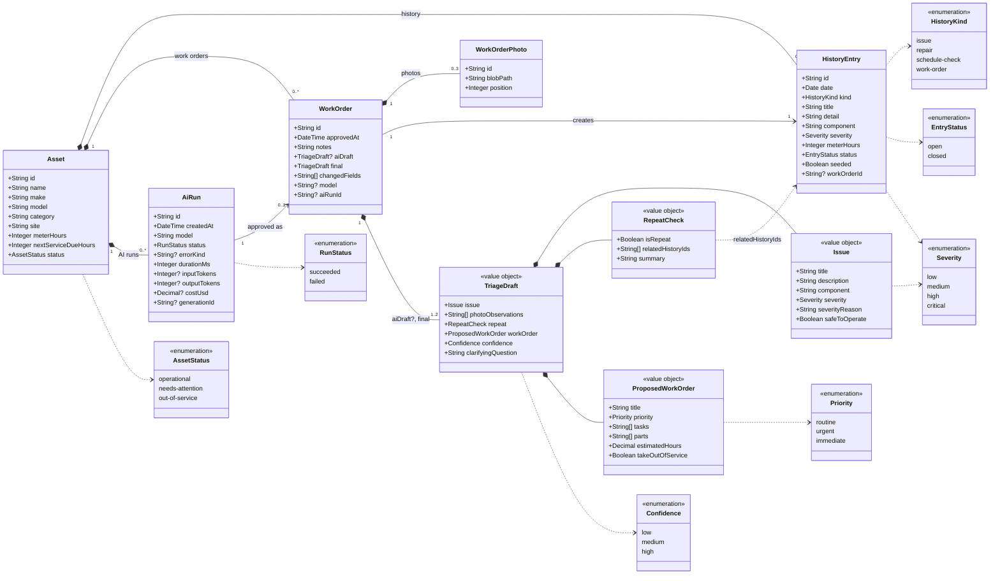

# Data Model — UML Class Diagram

Status: Draft 3 (12 Nov 2026). Matches [technical plan version 3](technical-plan-v3.md), section 5. [Draft 2](data-model-v2.md) is kept for comparison.

## Changes from draft 2

| Change | Draft 2 | Draft 3 | Why |
|---|---|---|---|
| `AiRun` | Not modelled | New class and table `ai_runs`: one row per AI draft request, measurements only | R39: cost, tokens and time for every draft, including ones that are discarded or fail |
| `WorkOrder.aiRunId` | Not modelled | Optional link to the run whose draft was approved | R40: tells approved drafts from ones that were not, and links edit measures to model and cost |
| `RunStatus` | Not modelled | New enumeration: `succeeded`, `failed` | Failed requests are counted too |
| Discard rule | Discarding leaves nothing in the database | Discarding leaves only the run's measurements | R21 changed in requirements version 6 |

## Diagram

## How to read it

| Class | Stored as | Purpose |
|---|---|---|
| Asset | Database table `assets` | A piece of plant. Its `id` is also what the QR code contains |
| HistoryEntry | Database table `history_entries` | One past event on an asset: an issue, repair, schedule check or work order |
| WorkOrder | Database table `work_orders` | An approved triage, drafted by the AI or entered by hand. Created only when a reviewer approves |
| WorkOrderPhoto | Database table `work_order_photos`; the image itself is in Vercel Blob | A photo submitted with the defect report |
| TriageDraft and its parts | JSON inside a work order, twice: `aiDraft` and `final` | What the AI proposed and what the reviewer approved |
| AiRun | Database table `ai_runs` | One AI draft request: model, outcome, time, tokens and cost. Holds no draft content, notes or photos |

## Relationships

- An asset owns its history entries and work orders. Removing an asset would remove them.
- A work order has up to 3 photos (R7).
- Approving a work order creates exactly one history entry of kind `work-order`, so it shows on the asset's timeline (R24).
- A work order always holds the approved draft (`final`). When the AI drafted it, it also holds the AI's draft and the model, and comparing the two gives `changedFields` (R22). A work order entered by hand has no AI draft, no model and no changed fields.
- An asset owns its AI runs. Every draft request makes one, whether it succeeds or fails (R39).
- A work order drafted by the AI links to the one run whose draft was approved. A run links to at most one work order. A run with no work order was discarded, abandoned, failed, or replaced by a clarification re-run (R40).
- A repeat check refers to existing history entries by ID. The server discards any ID that is not a real entry for that asset, so the AI cannot cite history that does not exist.

## Rules the diagram cannot show

- A triage draft is never stored on its own. Discarding one leaves only its AI run, which holds measurements and no content (R21).
- `seeded` marks demo starting data, so the seed script can restore it (R29).
- `aiDraft`, `model` and `aiRunId` are all empty or all set. When set, `model` matches the run's model.
- Only a run with status `succeeded`, for the same asset, can be linked to a work order.
- A failed run has no tokens, cost or generation ID, and records only the kind of failure, never the error text.
- `costUsd` is filled in after the draft is returned, and can stay empty if AI Gateway does not report it. Empty means unknown, not zero.
- If the approved draft has `takeOutOfService` set, the asset's status becomes `out-of-service` in the same transaction as the work order (R25, R27).
- No user or approver is modelled. Login is out of scope for the demo.
