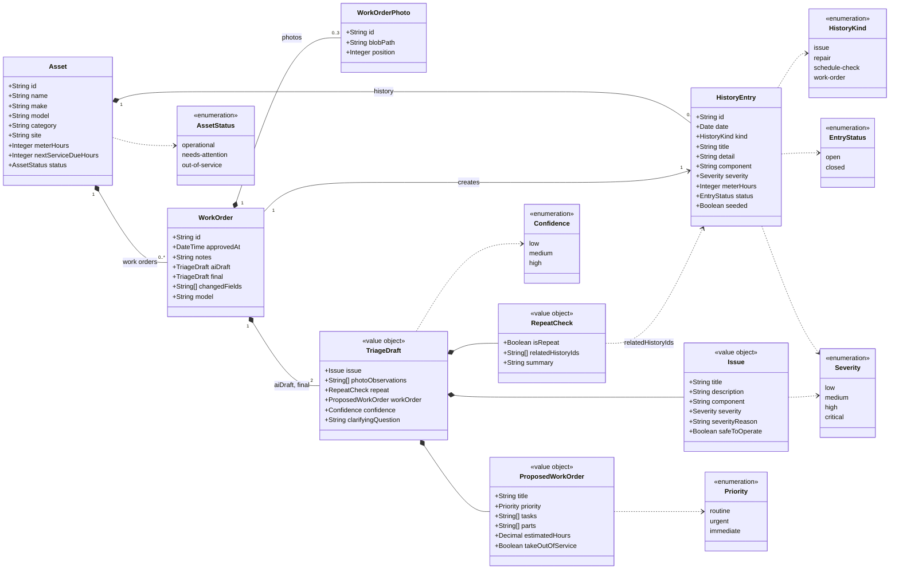

# Data Model — UML Class Diagram

Status: Draft 1 (11 Nov 2026). Matches [technical plan version 2](technical-plan-v2.md), section 4. Nothing here is built yet.

## Diagram

## How to read it

| Class | Stored as | Purpose |
|---|---|---|
| Asset | Database table `assets` | A piece of plant. Its `id` is also what the QR code contains |
| HistoryEntry | Database table `history_entries` | One past event on an asset: an issue, repair, schedule check or work order |
| WorkOrder | Database table `work_orders` | An approved triage. Created only when a reviewer approves |
| WorkOrderPhoto | Database table `work_order_photos`; the image itself is in Vercel Blob | A photo submitted with the defect report |
| TriageDraft and its parts | JSON inside a work order, twice: `aiDraft` and `final` | What the AI proposed and what the reviewer approved |

## Relationships

- An asset owns its history entries and work orders. Removing an asset would remove them.
- A work order has up to 3 photos (R7).
- Approving a work order creates exactly one history entry of kind `work-order`, so it shows on the asset's timeline (R24).
- A work order holds two triage drafts. Comparing them gives `changedFields` (R22).
- A repeat check refers to existing history entries by ID. The server discards any ID that is not a real entry for that asset, so the AI cannot cite history that does not exist.

## Rules the diagram cannot show

- A triage draft is never stored on its own. Discarding one leaves nothing in the database (R21).
- `seeded` marks demo starting data, so the seed script can restore it (R29).
- If the approved draft has `takeOutOfService` set, the asset's status becomes `out-of-service` in the same transaction as the work order (R25, R27).
- No user or approver is modelled. Login is out of scope for the demo.
