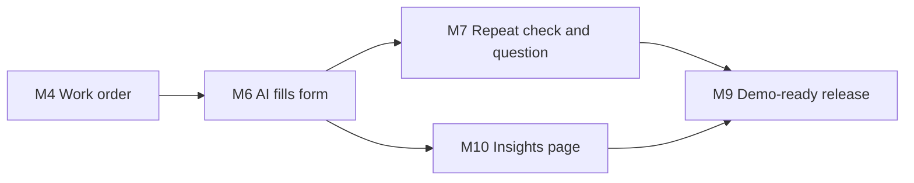

# Plant Defect Triage — Milestones

Status: Draft 2 (12 Nov 2026). Based on [requirements version 6](requirements-v6.md) and [technical plan version 3](technical-plan-v3.md). Revised from [draft 1](milestones.md).

Draft 2 adds measurement of the AI draft step. This file lists only what changed. Every milestone in draft 1 that is not mentioned here is unchanged. The Linear tickets have not been updated yet.

## Changes from draft 1

| Area | Draft 1 | Draft 2 | Why |
|---|---|---|---|
| Milestone 6 | AI draft fills the form | Also records every AI request and links the approved work order to it | R39, R40. Recording has to be built with the triage route, or the first drafts go unmeasured |
| Milestone 10 | | New: Insights page | R41 to R43. A separate milestone so milestone 6 stays a small, testable deliverable, and so it ends with a page a person can use |
| Milestone 9 | Compare Sonnet and Haiku on the test cases | Also uses the Insights page, narrowed by model, for the cost and time comparison | R43 |
| Dependencies | M6 → M7 → M9 | Adds M6 → M10 → M9 | The Insights page needs runs to show, and is used in the release checks |

## Summary additions

| # | Linear | Milestone | What a user can do at the end | Requirements |
|---|---|---|---|---|
| 6 | DUL-10 | AI fills the form (changed) | As in draft 1. Every draft request is also recorded with its model, tokens, cost and time | R12 to R15, R17 to R20, R22, R39, R40 |
| 10 | Not created yet | Insights page | See what AI drafts cost, how long they take, how often they are approved and how much reviewers change them, for all models or one | R41 to R43 |

### Dependencies

M10 and M7 both depend only on M6 and touch separate files, so they can be built alongside each other.

## 6. AI fills the form: added tasks

These are added to the draft 1 task list for milestone 6.

| Task | Notes |
|---|---|
| `ai_runs` table, `work_orders.ai_run_id`, and a migration | Data model draft 3 |
| Record a run for every triage request, succeeded or failed; return `runId` | R39. Plan v3, section 2. A failed insert must not fail the draft |
| Fetch the cost with `gateway.getGenerationInfo()` after the response, using `after()`; retry while the gateway ingests the request | R39. Plan v3, section 2 |
| Tag the Gateway requests `triage-draft` and set the telemetry `functionId` | Plan v3, changes table. Lets the requests be filtered in AI Gateway Logs |
| Send `aiRunId` with an approved AI draft; the server checks it and links it in the same transaction | R40. Plan v3, section 3 |
| Unit tests for the run insert and the link rules | Plan v3, section 7 |

Done when (added): each draft request, including a failed one, leaves one run with its tokens and time; its cost appears within a few minutes; approving the draft links the work order to that run.

## 10. Insights page

Deliverable: an Insights page for the AI draft step.

| Task | Notes |
|---|---|
| `db/insights.ts`: counts, cost and token averages and totals, p50 and p95 time, approval share, edit measures | R41, R42. Plan v3, section 4 |
| Unit tests for the edit measures and percentiles against fixed data | Plan v3, section 7 |
| `app/insights/page.tsx` with its panels in `_components/`; reads inside `<Suspense>` | R41, R42 |
| Model picker using `?model=` | R43 |
| Sample size on every figure; indicative label below 20 runs | Requirements v6, non-functional additions |
| Insights link in the header | |
| Playwright test with seeded runs and work orders | Plan v3, section 7 |

Done when: after a few drafts, some approved with edits and some discarded, the Insights page shows the right cost, p95 time, approval share and changed-field counts, and narrowing it to one model changes the figures to match.

## 9. Demo-ready release: changed task

| Task | Notes |
|---|---|
| Compare Sonnet 5.5 and Haiku 5.5 on the test cases; pick the default. Use the Insights page, narrowed by model, for cost and time | Plan v2, section 3; R43 |
