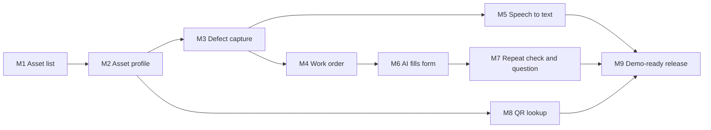

# Plant Defect Triage — Milestones

Status: Draft 1 (11 Nov 2026). Based on [requirements version 3](requirements-v3.md) and [technical plan version 2](technical-plan-v2.md). Nothing is built yet. Loaded into Linear (the project's Linear project, DUL-5 to DUL-63) on 11 Nov 2026. This is the source for the Linear tickets: each milestone becomes a parent ticket and each task a sub-ticket.

Every milestone ends with something a person can use in the app. Shared setup work is folded into the first milestone that needs it, rather than kept as a milestone with nothing to show.

## Summary

| # | Linear | Milestone | What a user can do at the end | Requirements |
|---|---|---|---|---|
| 1 | DUL-5 | Asset list | Open the app and see the seeded fleet, stored in the database, in the black and yellow theme with the disclaimer footer | R1, R4, R26, R29, R30, R32 |
| 2 | DUL-6 | Asset profile | Click an asset and see its facts and history, newest first | R5, R6 |
| 3 | DUL-7 | Defect capture (manual) | Add up to 3 photos and type notes for a defect on an asset | R7, R9, R10, R11, R34 |
| 4 | DUL-8 | Work order from issue | Fill in the issue and work order by hand, approve it, and see it on the asset's history | R20 to R22, R24 to R28 |
| 5 | DUL-9 | Speech to text | Dictate the defect notes instead of typing, and correct them | R8 |
| 6 | DUL-10 | AI fills the form | Get an AI draft of the issue and work order from the photos and notes, then edit and approve it | R12 to R15, R17 to R20, R22 |
| 7 | DUL-11 | AI repeat check and clarifying question | See when a defect repeats earlier history, with links, and answer the AI's question to re-run the draft | R16, R18, R23 |
| 8 | DUL-12 | QR code lookup | Upload a saved QR code image to open an asset | R2, R3 |
| 9 | DUL-13 | Demo-ready release | Run the whole flow on the protected Vercel URL in about two minutes, reset between takes | Section 7, 9, 12; R31 to R33 |

### Dependencies

Linked in Linear as "blocked by" relations between the milestone tickets.

M5 (speech to text) and M8 (QR lookup) sit off the main path, so they can be built alongside M4 to M7.

Milestones 1 to 4 make a complete manual flow with no AI. Milestones 5 to 7 add AI on top of a form that already works, which is also the fallback when an AI call fails (section 7, failure handling).

## 1. Asset list

Deliverable: the home page lists the demo fleet from the database.

| Task | Notes |
|---|---|
| Swap dependencies: remove `@anthropic-ai/sdk`; add `ai`, `zod`, Drizzle and the Neon driver | Read the bundled Next.js docs first (AGENTS.md) |
| Connect Vercel: link project, install Neon from the Marketplace, enable Blob, pull env vars | Needs your Vercel sign-in and approvals |
| Create the private GitHub repository | R31. Needs your GitHub sign-in; nothing pushed without confirmation |
| Database schema and first migration for all four tables | Section 4 of the plan. Done once so later milestones agree on shapes |
| Seed script with the four assets and their history, including the repeat set-up on the excavator | R29. `pnpm db:seed`; must run cleanly twice |
| Theme tokens (black and yellow) and app shell | R30. No vendor brand assets |
| Disclaimer footer on every screen; README opening disclaimer | R32, R33 |
| Fleet page: asset cards with name, ID, site and status | R1, R4 |

Done when: the fleet page shows all four seeded assets read from Neon, at 768px and desktop width.

## 2. Asset profile

Deliverable: each asset has a profile page.

| Task | Notes |
|---|---|
| Route `asset/[id]` with not-found handling | |
| Key facts panel: make, model, site, meter hours, next service due, status | R5 |
| History timeline, newest first, by kind (issue, repair, schedule check, work order) | R6 |
| Two-column layout on desktop, one column at tablet portrait | Plan section 7 |
| "Report a defect" entry point | Leads to milestone 3 |

Done when: every seeded asset opens from the fleet page with its full history in order.

## 3. Defect capture (manual)

Deliverable: a capture panel on the asset profile for photos and notes.

| Task | Notes |
|---|---|
| Photo drop zone: file picker and drag and drop, up to 3, preview and remove for each | R7 |
| Resize photos in the browser to about 1,500px on the longest side | Plan section 5 |
| Notes text box | R9. The same box voice will write into in milestone 5 |
| Validation: at least one photo or some notes before continuing | R10 |
| Bring the full-size sample photos into `demo-files/photos/` and complete `CREDITS.md` | R11, R34. Three are still in Canva at preview size |

Done when: a user can add, preview and remove photos, type notes, and cannot continue with neither.

## 4. Work order from issue

Deliverable: a person can raise an issue and approve a work order by hand, and it is saved.

| Task | Notes |
|---|---|
| Zod schema for `TriageDraft`, shared by the form, the approval route and later the AI | Plan section 4 |
| Issue and work order form: title, description, component, severity and reason, safe to operate, priority, tasks, parts, hours, take out of service | R20. The same form the AI fills in milestone 6 |
| `POST /api/work-orders`: upload photos to Blob, then one transaction for work order, history entry and status change; delete uploaded photos on failure | R24, R25, R27, R28 |
| Approve and Discard buttons; Discard saves nothing | R21 |
| Record approval time and changed fields (empty for a manual entry) | R22 |
| Show the new work order and photos on the asset's history; status updates | R24, R25 |

Data model change needed: `ai_draft` and `model` on `work_orders` must allow empty values, because a manual work order has no AI draft. The data model doc would get a draft 2.

Done when: an approved work order survives a refresh and shows in a second browser; a failed save leaves no rows or photos behind.

## 5. Speech to text

Deliverable: dictate defect notes.

| Task | Notes |
|---|---|
| Microphone button using Chrome `SpeechRecognition`; start and stop | R8. Chrome sends audio to Google for transcription; no AI model of ours is involved |
| Append recognised words to the notes box; dictate again to add more | R8, R9 |
| Listening indicator, and a message when the browser does not support it or the mic is blocked | |

Done when: in Chrome, a dictated note appears in the box and can be corrected by typing before submitting.

## 6. AI fills the form

Deliverable: one click turns photos and notes into a filled, editable form.

| Task | Notes |
|---|---|
| Prompt: system rules from requirements section 6, severity scale, user message with asset profile and history | Plan section 6 |
| `POST /api/triage` with AI SDK structured output through AI Gateway; model from `AI_GATEWAY_MODEL` | Loads history on the server; writes nothing |
| Request checks: notes or photos required, at most 3 photos, size limit | R7, R10 |
| "Draft with AI" button with progress; fills the milestone 4 form | |
| AI draft badge, photo observations shown apart from the operator's notes, confidence | R15, R18, R19 |
| Retry, or carry on by hand, when the AI call fails | Section 7 |
| Store the AI draft and the approved version; changed fields computed on the server | R22, R28 |

Done when: a sample photo and note produce a complete draft in about 10 seconds, the reviewer edits a field, approves, and the change is recorded.

## 7. AI repeat check and clarifying question

Deliverable: the AI points out repeats and asks rather than guesses.

| Task | Notes |
|---|---|
| Repeat check in the draft, with links to the earlier history entries | R16 |
| Server drops history IDs that are not real for the asset; no valid IDs means not a repeat | Plan section 5 |
| Highlight linked entries in the history column beside the claim | Plan section 7 |
| Show the clarifying question; reviewer answers and the draft re-runs | R18, R23 |

Done when: the excavator hose photo is flagged as a repeat linked to the seeded entries, and an unclear photo produces a question instead of a guess.

## 8. QR code lookup

Deliverable: upload a QR code image to open an asset.

| Task | Notes |
|---|---|
| Script to generate one QR PNG per asset into `demo-files/qr/` | R3 |
| "Upload QR code" on the fleet page; read the image with `jsqr` in the browser | R2 |
| Errors for no readable code or an unknown asset, with the list offered | R2 |

Done when: each saved QR image opens the right asset; a non-QR image and an unknown code each show a clear message.

## 9. Demo-ready release

Deliverable: the demo can be recorded on the live URL.

| Task | Notes |
|---|---|
| Fixed triage test cases per asset (clear, repeat, safety-critical, unclear photo, contradicting notes) | Plan section 11 |
| Compare Sonnet 5.5 and Haiku 5.5 on those cases; pick the default | Plan section 3 |
| Acceptance criteria pass, including 768px and desktop layouts | Requirements section 12 |
| Deploy to Vercel and re-test on the live URL; time the flow against two minutes | Needs your approval before the first deploy |
| Deployment protection and an AI Gateway spend limit | Open question 2; plan risks |
| `NOTICE.md` and final README | R32, R33 |
| Decide the app name | Open question 1 |
| Publish the build log page with usage checkpoints | Section 9 |

Done when: the full flow runs on the protected URL in about two minutes and `pnpm db:seed` restores a clean state between takes.

## Items from the docs that were not in the suggested outline

- QR code lookup (milestone 8).
- Repeat check and clarifying question (milestone 7), split from the AI form fill so each is a smaller, testable deliverable.
- Project setup, database, seed and reset (inside milestone 1).
- Theme, disclaimers, private repository and `NOTICE.md` (milestones 1 and 9).
- Sample photos and their credits (milestone 3).
- Model comparison, deployment, URL protection and spend limit (milestone 9).
- The build log page and usage checkpoints (milestone 9, recorded throughout).
- Two open questions: app name and deployed URL protection (milestone 9).
