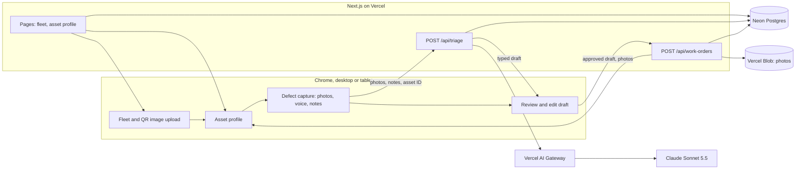
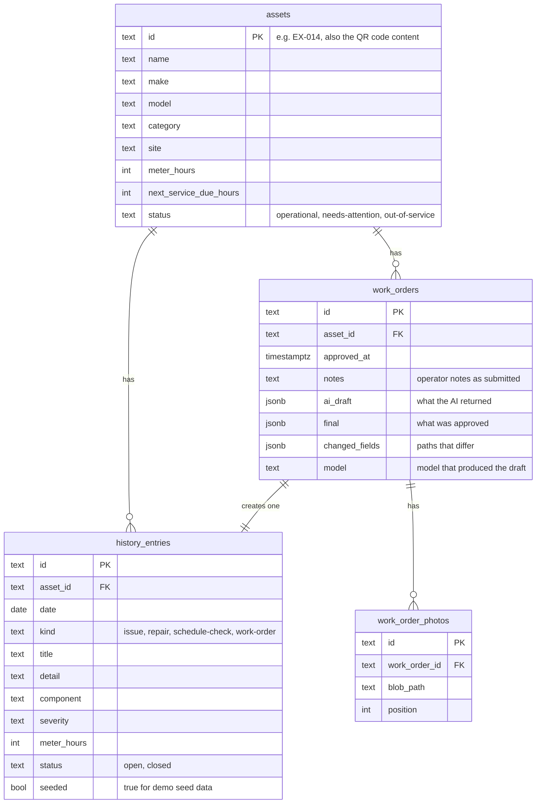

# Plant Defect Triage — Technical Plan

A concept for Sitemate's Gearbelt. Named "Gearbelt Defect Triage" in version 1.

Status: Version 2 (11 Nov 2026). Implements [requirements version 3](requirements-v3.md). Revised from [version 1](technical-plan.md). Nothing in this plan is built yet.

## Changes from version 1

| Area | Version 1 | Version 2 |
|---|---|---|
| Storage | Seeded assets in code; approved work orders in the browser's local storage | Postgres database (Neon, through the Vercel Marketplace) for assets, history and work orders |
| Photos | Sent to the AI, then discarded | Kept with the work order in Vercel Blob (confirmed) |
| Data access | Browser reads local storage | Server reads and writes the database; browser never talks to it directly |
| Approval | Written in the browser | `POST /api/work-orders` writes the work order, history entry and status change in one transaction |
| Reset between takes | Button clears local storage | `pnpm db:seed` restores the seeded state |
| Build order | Vercel connected at step 6 | Vercel and the database connected at step 2, because the data layer needs them |
| New risk | | Public URL can write to the database with no login |

## 1. Current state of the folder

| Item | State |
|---|---|
| Next.js 16.4 app (App Router, TypeScript, Tailwind 4, pnpm) | Scaffolded, default starter page only |
| `jsqr`, `qrcode` | Installed, needed |
| `@anthropic-ai/sdk` | Installed before the switch to the Vercel AI SDK. To be removed |
| `ai`, `zod`, database client and ORM | Not installed yet |
| Vercel CLI | Not installed on this machine |
| Git | Repository initialised by the scaffold, no remote |

The scaffold's `AGENTS.md` warns that this Next.js version differs from older ones and that the bundled docs in `node_modules/next/dist/docs/` must be read before writing code. The build will follow that.

## 2. Architecture



- The browser handles QR reading, photo previews and speech recognition.
- The server owns all data. Pages read assets and history from the database; two routes handle the AI call and the approval.
- The triage route loads the asset and its history from the database itself, so the browser cannot feed the model invented history.
- No secrets reach the browser.

## 3. Stack decisions

| Area | Choice | Notes |
|---|---|---|
| Framework | Next.js 16 App Router, TypeScript | Already scaffolded |
| Styling | Tailwind 4 | Already scaffolded |
| AI SDK | `ai` package, `generateText` with `Output.object` and a Zod schema | The current AI SDK way to get typed structured output. Exact options will be checked against the installed package's bundled docs |
| Model access | Vercel AI Gateway with a plain `provider/model` string | No provider package needed |
| Model | `anthropic/claude-sonnet-5.5` | Confirmed on the live Gateway model list, with vision and structured output |
| Auth to Gateway | Vercel OIDC: automatic on Vercel, `vercel env pull` locally | No long-lived key to manage |
| Database | Neon Postgres, installed through the Vercel Marketplace | Vercel no longer has its own Postgres; Marketplace databases set their connection variables on the project automatically. The exact install command will be confirmed with `vercel integration discover` once the CLI is installed |
| Database access | Drizzle ORM with Neon's serverless driver | Typed queries and schema in TypeScript; migrations from the same schema file |
| Photo storage | Vercel Blob, private | Confirmed. Photo addresses are stored on the work order |
| Voice | Chrome `SpeechRecognition` | Chrome sends the audio to Google for transcription |
| QR reading | `jsqr` on a canvas drawn from the uploaded image | Runs in the browser |
| QR images | Generated once by a script using `qrcode`, saved as PNG files | Encodes the asset ID |
| Hosting | Vercel | |
| Styling | Black and yellow theme, defined as colour tokens in one place | No Sitemate brand assets (R30). Sitemate's site blocked automated reading, so its current colours are unverified; compare by eye before recording |
| Repository | Private GitHub repository | Created as private from the start (R31). Needs your GitHub sign-in |

One database is used for both local development and the deployed app, to keep the demo simple.

### Model choice

Prices are from the live Gateway model list on 11 Nov 2026.

| Model | Input per 1M tokens | Output per 1M tokens | Role |
|---|---|---|---|
| Claude Sonnet 5.5 | $2.00 | $10.00 | Default |
| Claude Haiku 5.5 | $0.10 | $0.50 | Comparison in testing |

Sonnet is the default because the task combines reading photos, judging safety severity and matching against history, and a wrong severity is the costly error. A triage with three photos should cost roughly one to three cents on Sonnet. The model ID lives in one environment variable, `AI_GATEWAY_MODEL`, so Haiku can be swapped in without a code change. Step 8 runs the same test cases on both; if Haiku passes them all, it becomes the default.

## 4. Data model

### Database tables



- Keeping both `ai_draft` and `final` satisfies R22 and makes it possible to show how often reviewers overrule the AI, which is a useful point for the interview.
- The `seeded` flag lets the seed script restore the starting state without touching the schema.

### Triage draft

The shape the model returns, stored as `ai_draft` and `final`:

```ts
type Severity = "low" | "medium" | "high" | "critical";

interface TriageDraft {
  issue: {
    title: string;
    description: string;
    component: string;
    severity: Severity;
    severityReason: string;
    safeToOperate: boolean;
  };
  photoObservations: string[];
  repeat: {
    isRepeat: boolean;
    relatedHistoryIds: string[];
    summary: string;
  };
  workOrder: {
    title: string;
    priority: "routine" | "urgent" | "immediate";
    tasks: string[];
    parts: string[];
    estimatedHours: number;
    takeOutOfService: boolean;
  };
  confidence: "low" | "medium" | "high";
  clarifyingQuestion: string | null;
}
```

One Zod schema defines `TriageDraft` for the model, validates its response, and validates the approved version before it is saved.

Seeded fleet (subject to open question 1): an excavator, a telehandler, a light vehicle and a generator. At least two assets get history that sets up a repeat finding, for example two earlier hydraulic hose repairs on the excavator's boom.

## 5. API

### `POST /api/triage`

| | |
|---|---|
| Request | `{ assetId, notes, photos: [{ mediaType, data }], clarification? }` |
| Success | `{ draft: TriageDraft, model: string, durationMs: number }` |
| Errors | 400 for a bad request or unknown asset, 502 when the model call fails, each with a plain message the screen can show |

Writes nothing. Server-side rules:

- Reject requests with no photos and no notes (R10), more than 3 photos (R7), or oversized images.
- Drop any `relatedHistoryIds` that are not real entries for that asset, so a repeat finding can never point at invented history.
- If the model reports a repeat but no valid IDs remain, set `isRepeat` to false.

### `POST /api/work-orders`

| | |
|---|---|
| Request | `{ assetId, notes, aiDraft, final, model, photos }` |
| Success | `{ workOrderId }` |
| Errors | 400 for an invalid draft or unknown asset, 500 if the save fails |

In one database transaction: insert the work order, insert a history entry for it, and set the asset to out of service if the approved draft says so (R24, R25). `changedFields` is computed on the server by comparing `aiDraft` with `final`. Photos are uploaded to Blob first; if the transaction fails, the uploaded photos are deleted.

Discard calls nothing, so it leaves no trace (R21).

Photos are resized in the browser to a longest side of about 1,500px before upload, which keeps requests small and responses fast.

## 6. Prompt design

- **System prompt:** the role (maintenance triage assistant for plant and equipment), the behaviour rules from requirements section 6, the severity scale with examples, and the instruction to ask one clarifying question rather than guess.
- **User message:** the asset profile and history as structured text with entry IDs, the operator's notes, then the photos.
- **Separation of evidence:** the prompt asks for photo observations separately from the operator's account (R15), so a reviewer can see what the AI saw versus what it was told.
- **Clarification loop (R23):** the reviewer's answer is sent back with the original inputs for a fresh draft.

## 7. Screens

| Screen | Contents | Requirements |
|---|---|---|
| Fleet | Asset cards with status; "Upload QR code" button | R1, R2, R4 |
| Asset profile | Key facts, history timeline, "Report a defect" | R5, R6, R24, R25 |
| Defect capture | Photo drop zone with previews, microphone button, editable notes box | R7 to R10 |
| Review | AI draft badge, editable issue and work order, repeat links, photo observations, clarifying question, Approve and Discard | R12 to R23 |

Layout: two columns on desktop, with the asset's facts and history on the left and capture or review on the right, so the repeat finding sits beside the history it refers to. One column at tablet portrait width.

Voice input detail (R8): the microphone button starts and stops dictation. Recognised words are appended to the notes box. The box is an ordinary text area, so corrections are made by typing.

## 8. File layout

```
app/
  page.tsx                    Fleet
  asset/[id]/page.tsx         Asset profile, capture and review
  api/triage/route.ts         AI call
  api/work-orders/route.ts    Approval
components/                   Screen components
db/
  schema.ts                   Drizzle tables from section 4
  client.ts                   Database connection
  queries.ts                  Reads and writes used by pages and routes
  seed.ts                     Seeded fleet and history; restores the starting state
lib/
  schema.ts                   Zod schema and TriageDraft type
  prompt.ts                   System prompt and message builder
  qr.ts                       Read a QR code from an image file
scripts/
  make-qr.ts                  Generates the QR code images
demo-files/
  qr/                         One QR code PNG per asset (R3)
  photos/                     Sample defect photos (R11)
docs/                         Requirements, plans, usage log
```

## 9. Build steps

| Step | Work | Depends on |
|---|---|---|
| 1 | Swap dependencies: remove `@anthropic-ai/sdk`, add `ai`, `zod` and the database packages. Read the bundled Next.js and AI SDK docs | |
| 2 | Connect Vercel: link the project, install the database from the Marketplace, enable Blob, pull environment variables | 1, and your Vercel sign-in |
| 3 | Shared contract: Zod schema, database tables, migration, seed script. Run the seed | 2 |
| 4a | Triage route and prompt | 3 |
| 4b | Fleet screen, QR image upload, asset profile | 3 |
| 4c | QR image generator script and the saved QR files | 3 |
| 5 | Capture screen: photos, voice, notes | 4b |
| 6 | Review screen and the approval route | 4a, 5 |
| 7 | First live triage end to end | 6 |
| 8 | Test against the acceptance criteria; compare Sonnet and Haiku | 7 |
| 9 | Deploy to Vercel and re-test on the live URL | 8 |
| 10 | Publish the build log page, including the usage checkpoints from `docs/usage-log.md`. A checkpoint is recorded after each build step | Runs alongside, finished last |

Steps 4a, 4b and 4c touch separate files and depend only on the shared contract from step 3, so they can run as parallel agents. Step 3 is done first, in one place, precisely so the parallel pieces agree on the data shapes.

## 10. Things you will need to do

These need your Vercel account, so I cannot do them for you:

1. Install the Vercel CLI and sign in:

```bash
npm i -g vercel
```

```bash
vercel login
```

2. Approve linking this folder to a new Vercel project at step 2.
3. Approve installing the database from the Marketplace. This may open a browser page to accept the provider's terms. Neon has a free tier, which is enough for this demo.
4. Confirm AI Gateway is enabled on your Vercel team with some credit available.

Deploying publishes the app at a public URL. I will ask before the first deploy.

## 11. Testing

| Check | How |
|---|---|
| Types and lint | `tsc` and `eslint` after each step |
| Database | Seed runs cleanly twice in a row; a failed approval leaves no partial rows |
| QR lookup | Upload each saved QR image; upload a non-QR image; upload a code for an unknown asset |
| Triage quality | Fixed cases per asset: a clear defect, a repeat of seeded history, a safety-critical defect, an unclear photo, notes that contradict the photo |
| Model comparison | The same cases on Sonnet 5.5 and Haiku 5.5, comparing severity, repeat detection and response time |
| Review flow | Edit fields, approve, confirm changed fields are recorded and history updates; discard leaves nothing |
| Persistence | An approved work order is still there after a refresh and in a second browser |
| Layout | Chrome at 768px and at desktop width |
| Live | Full flow on the deployed URL, timed against the two-minute target |

## 12. Risks

| Risk | Mitigation |
|---|---|
| The public URL has no login, so anyone who finds it can write work orders and spend AI credit | Keep the URL unshared until the interview; set a spend limit on AI Gateway; the seed script restores clean data. A shared passcode can be added if you want one |
| Speech recognition mishears plant terms | The transcript is editable (R8); typed notes always work |
| The model flags a repeat that is not one | Server-side check of history IDs; reviewer sees the linked entries beside the claim |
| Slow responses with three large photos | Resize in the browser; show progress; measure in step 8 |
| Sample photos are unconvincing or wrongly licensed | Use only AI-generated or CC0 images with a credits file (section 13); review each at full size before step 8 |
| The demo is mistaken for a Sitemate product, or raises an IP concern | Private repository, disclaimers in the README and on every screen, a neutral app name, no Sitemate brand assets (section 13) |
| Data from earlier takes shows up in a recording | Run the seed script before each take |
| Database setup stalls on an account or browser step | It is step 2, so it surfaces before any feature work depends on it |
| Next.js 16 and AI SDK APIs differ from older versions | Read the bundled docs first (step 1); type-check after every step |

## 13. Repository, disclaimers and sample photos

Added after version 2 was first saved, to record decisions made on 11 Nov 2026.

### Repository and disclaimers (R31 to R33)

- The repository is created as private on GitHub. Nothing is pushed until you confirm.
- `README.md` opens with the disclaimer from requirements section 5.8.
- A footer component shows a short form of the disclaimer on every screen.
- A `NOTICE.md` file lists what the demo does and does not contain: no Sitemate code, data or brand assets; fictional asset data; third-party libraries under their own licences.
- A private repository does not make the deployed app private. Vercel deployment protection is proposed for the URL (the open question in the requirements).
- The app's name is "Plant Defect Triage", shown with the subtitle "A concept for Gearbelt". The package name, page title and repository name follow it.

### Sample defect photos (R11, R34)

A search of Wikimedia Commons found few photos of defects on plant, and most usable ones carry share-alike licences. The plan is therefore one public-domain photo and AI-generated images for the rest.

| Asset | Defect shown | Source | Licence | Test case it supports |
|---|---|---|---|---|
| Excavator | Hydraulic hose leaking at a boom fitting | AI-generated (Canva) | Generated for this demo | Repeat of seeded history |
| Telehandler | Deep cut in a tyre sidewall | AI-generated (Canva) | Generated for this demo | Safety-critical, take out of service |
| Light vehicle | Cracked windscreen | AI-generated (Canva) | Generated for this demo | Medium severity, still operable |
| Generator | Corroded starting battery terminal | Wikimedia Commons, "Battery Terminal Corrision.jpg" | CC0 (public domain) | Low to medium severity |

- All four photos are saved in `demo-files/photos/` and were checked at full size; each shows its defect clearly. The generated ones were exported from Canva at 1456 × 1088.
- An unclear-photo test case will be made by blurring one of these.
- `demo-files/photos/CREDITS.md` lists each file's source and licence.
- Generated images are labelled as such in the credits file and in the build log.

## 14. After the demo

- Phone layout with live camera capture and live QR scanning.
- Login, which would also restore approver identity.
- The same triage draft written back to Gearbelt through its API.
