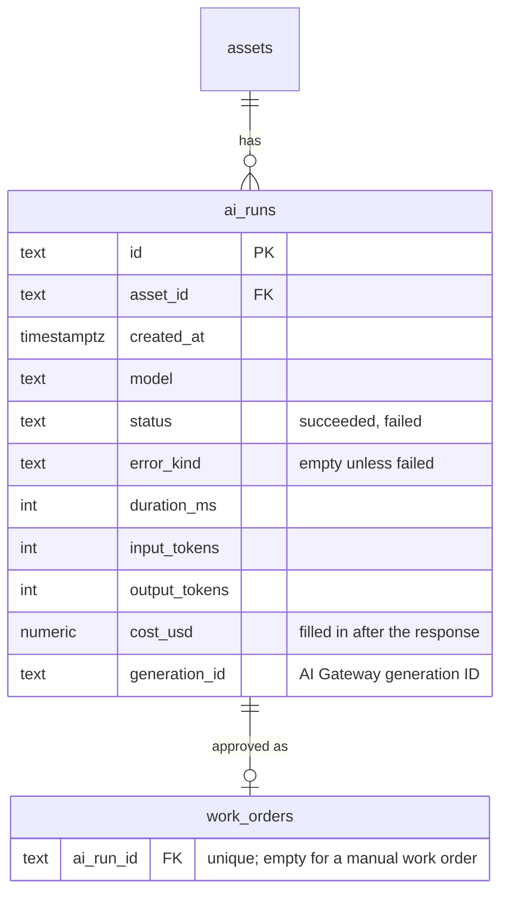

# Plant Defect Triage — Technical Plan

Status: Version 3 (12 Nov 2026). Implements [requirements version 6](requirements-v6.md). Revised from [version 2](technical-plan-v2.md).

Version 3 adds measurement of the AI draft step. This file lists only what changed. Every section of version 2 that is not mentioned here still applies.

## Changes from version 2

| Area | Version 2 | Version 3 |
|---|---|---|
| What `POST /api/triage` writes | Nothing | One `ai_runs` row per request: measurements only, no content (R39) |
| `POST /api/triage` response | `{ draft, model, durationMs }` | Adds `runId` |
| `POST /api/work-orders` request | `{ assetId, notes, aiDraft, final, model, photos }` | Adds `aiRunId` when the draft came from the AI, linking the work order to its run (R40) |
| Database | Four tables | Adds `ai_runs`, and `work_orders.ai_run_id` |
| Packages | `ai` only for model access | Adds `@ai-sdk/gateway` as a direct dependency, for `gateway.getGenerationInfo()`. It is already installed as a dependency of `ai` |
| Screens | Fleet, asset profile, capture, review | Adds an Insights page (R41 to R43) |
| Gateway request options | None | `providerOptions.gateway.tags` set to `["triage-draft"]`, so the requests can be filtered in AI Gateway Logs |

## 1. Where each measure comes from

| Measure | Source | Plan needed |
|---|---|---|
| Tokens per draft | `result.usage.inputTokens` and `outputTokens` from `generateText` | Any |
| Cost in dollars | `gateway.getGenerationInfo({ id })`, using `providerMetadata.gateway.generationId` from the result. Returns `totalCost` in USD | Any |
| Request time | Measured in the route with `performance.now()` around the model call. AI Gateway Logs also show duration and time to first token for each request | Any |
| Edit measures | `work_orders.ai_draft`, `final` and `changed_fields`, which milestone 4 already stores | Any |
| Approval share | `ai_runs` joined to `work_orders.ai_run_id` | Any |

AI Gateway's own dashboard (Overview and Logs) needs no code and is used for checking single requests: status, provider attempts, tokens, cost and timing. Its Logs can be filtered by the `triage-draft` tag and exported as CSV.

### Considered and not used

| Option | Why not |
|---|---|
| AI Gateway AI Traces and Trace Drains | Need a Pro or Enterprise plan. Gateway Logs already cover single requests |
| AI Gateway Custom Reporting | Needs a Pro or Enterprise plan, is in beta, and bills each write and query. A SQL query over `ai_runs` gives the same totals for this demo |
| OpenTelemetry (`@ai-sdk/otel` with `@vercel/otel`) | A few lines in `instrumentation.ts`, but the traces need somewhere to go. Vercel's trace view needs a paid plan, and a third-party tracing service would receive draft content unless recording is turned off. Can be added later without changing anything here |
| A third-party LLM monitoring service | Adds an account and sends data outside Vercel. Nothing in R39 to R43 needs it |

## 2. Recording a run (R39)

In `POST /api/triage`:

1. Validate the request as in version 2.
2. Time the `generateText` call. Pass `telemetry: { functionId: "triage-draft" }` and `providerOptions: { gateway: { tags: ["triage-draft"] } }`. Check both option names against the installed `ai` and `@ai-sdk/gateway` docs before writing the code.
3. Insert one `ai_runs` row with the asset, model, outcome, duration, tokens and generation ID. Do this whether the call succeeded or failed. A failed call has no tokens, and records only the kind of failure (for example `gateway-error` or `invalid-output`), not the error text.
4. Return `{ draft, model, durationMs, runId }`.
5. Fetch the cost after the response has been sent, using Next.js `after()`. Read the bundled `after` docs in `node_modules/next/dist/docs/` first. Call `gateway.getGenerationInfo()` and write `totalCost` to `ai_runs.cost_usd`. The gateway can take about 90 seconds to ingest a request, so retry a few times with a growing delay. If cost is still unavailable, leave it empty. The Insights page counts runs that are missing a cost rather than treating them as zero.

The insert must not block or fail the draft: if it fails, log the error and still return the draft, with `runId` set to null.

A clarification re-run (R23) is a new request and gets its own run. Only the run whose draft is approved is linked to the work order. Earlier runs count as not approved, which is accurate: those drafts were replaced.

## 3. Linking the approval (R40)

`POST /api/work-orders` takes an optional `aiRunId`. The server checks that the run exists, succeeded, belongs to the same asset and is not already linked to another work order, then stores it on the work order in the same transaction. An invalid `aiRunId` is a 400. `aiRunId`, `aiDraft` and `model` are either all set or all empty.

Discard still calls nothing, so a discarded draft simply leaves a run with no work order (R21).

## 4. Insights page (R41 to R43)

Route `app/insights/page.tsx`, a Server Component. The database reads sit inside a `<Suspense>` boundary, because Cache Components are on. An optional `?model=` search parameter narrows every figure to one model (R43), and a model picker lists the models found in `ai_runs`.

The queries live in `db/insights.ts`, so they can be tested apart from the page.

| Panel | Query |
|---|---|
| Requests | Count of runs; count where `status = 'failed'` |
| Cost per draft | Average and sum of `input_tokens`, `output_tokens` and `cost_usd` over succeeded runs; count of succeeded runs with no cost yet |
| Request time | `percentile_cont(0.5)` and `percentile_cont(0.95) within group (order by duration_ms)` over succeeded runs, with the count |
| Approval share | Succeeded runs with a linked work order, divided by all succeeded runs |
| Edit measures | Over work orders with an `ai_run_id`: the share with no changed fields; the average count of changed fields out of 12; the count per field path; severity raised or lowered, from comparing the severity in `ai_draft` and `final` on the scale low < medium < high < critical |

Only the 12 review form fields count as changes: `issue.title`, `issue.description`, `issue.component`, `issue.severity`, `issue.severityReason`, `issue.safeToOperate`, `workOrder.title`, `workOrder.priority`, `workOrder.tasks`, `workOrder.parts`, `workOrder.estimatedHours` and `workOrder.takeOutOfService`. Each panel shows its sample size, and a percentile from fewer than 20 runs is labelled as indicative.

Figures are shown as numbers and plain tables, plus a bar for each field's change count. Colours follow the theme rules in `CLAUDE.md`. Bars carry their numbers as text, never colour alone.

A link to the Insights page goes in the header.

### What the edit measure does not capture

A changed field counts once whether the reviewer fixed a typo or rewrote it, and a reworded task list counts the same as a new one. If that matters later, a text-difference score per field can be added from the stored `ai_draft` and `final`, without changing the schema.

## 5. Data model

See [data model draft 3](data-model-v3.md).



`ai_runs.asset_id` deletes on cascade, so `pnpm db:seed`, which deletes and re-creates the assets, also clears the runs, and each take starts with an empty Insights page. A seeded set of runs for the demo can be added later if an empty page records badly.

## 6. File layout additions

```
app/
  insights/page.tsx           Insights page
  insights/_components/       Panels used only by the Insights page
db/
  insights.ts                 Insights queries
  ai-runs.ts                  Insert a run, set its cost, link it to a work order
```

## 7. Testing additions

| Check | How |
|---|---|
| Recording | Unit-test the run insert and the work order link rules: wrong asset, failed run, run already linked |
| Edit measures | Unit-test the per-field counts and severity direction against fixed `ai_draft` and `final` pairs |
| Percentiles | Unit-test against a small set of seeded runs with known durations |
| Insights page | Playwright: seed runs and work orders, check the panels' figures and that `?model=` narrows them |
| Live | One real draft: its run appears with tokens and duration at once, and with a cost within a few minutes. The same request shows in AI Gateway Logs under the `triage-draft` tag |

## 8. Risks

| Risk | Mitigation |
|---|---|
| Cost lookup is slow or not yet ingested | Fetched after the response, retried, and shown as missing rather than zero. Gateway Logs remain the source of truth |
| Too few runs for a meaningful p95 | Sample size shown on every figure; indicative label below 20 runs |
| The public URL lets anyone see the Insights page | It shows only counts, costs and timings, no content. Covered by the deployment protection question already open |
| Recording slows the draft | One small insert on the request path; the cost lookup runs after the response |
