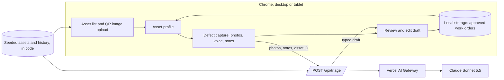

# Gearbelt Defect Triage — Technical Plan

Status: Draft 1 (11 Nov 2026). Implements [requirements version 2](requirements-v2.md). Nothing in this plan is built yet.

## 1. Current state of the folder

| Item | State |
|---|---|
| Next.js 16.4 app (App Router, TypeScript, Tailwind 4, pnpm) | Scaffolded, default starter page only |
| `jsqr`, `qrcode` | Installed, needed |
| `@anthropic-ai/sdk` | Installed before the switch to the Vercel AI SDK. To be removed |
| `ai` (Vercel AI SDK), `zod` | Not installed yet |
| Vercel CLI | Not installed on this machine |
| Git | Repository initialised by the scaffold, no remote |

The scaffold's `AGENTS.md` warns that this Next.js version differs from older ones and that the bundled docs in `node_modules/next/dist/docs/` must be read before writing code. The build will follow that.

## 2. Architecture



- The browser handles QR reading, photo previews, speech recognition and storage of approved work orders.
- One server route does the AI call. The key never reaches the browser.
- The server looks up the asset and its history itself from the asset ID, so the browser cannot feed the model invented history.

## 3. Stack decisions

| Area | Choice | Notes |
|---|---|---|
| Framework | Next.js 16 App Router, TypeScript | Already scaffolded |
| Styling | Tailwind 4 | Already scaffolded |
| AI SDK | `ai` package, `generateText` with `Output.object` and a Zod schema | The current AI SDK way to get typed structured output. Exact options will be checked against the installed package's bundled docs |
| Model access | Vercel AI Gateway with a plain `provider/model` string | No provider package needed |
| Model | `anthropic/claude-sonnet-5.5` | Confirmed on the live Gateway model list today, with vision and structured output |
| Auth to Gateway | Vercel OIDC: automatic on Vercel, `vercel env pull` locally | No long-lived key to manage |
| Voice | Chrome `SpeechRecognition` | Chrome sends the audio to Google for transcription |
| QR reading | `jsqr` on a canvas drawn from the uploaded image | Runs in the browser |
| QR images | Generated once by a script using `qrcode`, saved as PNG files | Encodes the asset ID |
| Persistence | Browser local storage | Per browser; cleared with a reset button for re-recording |
| Hosting | Vercel | |

### Model choice

Prices are from the live Gateway model list on 11 Nov 2026.

| Model | Input per 1M tokens | Output per 1M tokens | Role |
|---|---|---|---|
| Claude Sonnet 5.5 | $2.00 | $10.00 | Default |
| Claude Haiku 5.5 | $0.10 | $0.50 | Comparison in testing |

Sonnet is the default because the task combines reading photos, judging safety severity and matching against history, and a wrong severity is the costly error. A triage with three photos should cost roughly one to three cents on Sonnet. The model ID lives in one environment variable, `AI_GATEWAY_MODEL`, so Haiku can be swapped in without a code change. Step 7 runs the same test cases on both; if Haiku passes them all, it becomes the default.

## 4. Data model

```ts
type Severity = "low" | "medium" | "high" | "critical";
type AssetStatus = "operational" | "needs-attention" | "out-of-service";

interface Asset {
  id: string;               // e.g. "EX-014", also the QR code content
  name: string;
  make: string;
  model: string;
  category: string;
  site: string;
  meterHours: number;
  nextServiceDueHours: number;
  status: AssetStatus;
  history: HistoryEntry[];
}

interface HistoryEntry {
  id: string;
  date: string;             // ISO date
  kind: "issue" | "repair" | "schedule-check" | "work-order";
  title: string;
  detail: string;
  component?: string;
  severity?: Severity;
  meterHours?: number;
  status: "open" | "closed";
}

interface TriageDraft {
  issue: {
    title: string;
    description: string;
    component: string;
    severity: Severity;
    severityReason: string;
    safeToOperate: boolean;
  };
  photoObservations: string[];
  repeat: {
    isRepeat: boolean;
    relatedHistoryIds: string[];
    summary: string;
  };
  workOrder: {
    title: string;
    priority: "routine" | "urgent" | "immediate";
    tasks: string[];
    parts: string[];
    estimatedHours: number;
    takeOutOfService: boolean;
  };
  confidence: "low" | "medium" | "high";
  clarifyingQuestion: string | null;
}

interface ApprovedWorkOrder {
  id: string;
  assetId: string;
  approvedAt: string;       // ISO timestamp
  final: TriageDraft;       // as approved
  changedFields: string[];  // paths that differ from the AI draft
  notes: string;
  photoCount: number;
}
```

The same Zod schema defines `TriageDraft` for the model and validates the response, so the type and the AI output cannot drift apart.

Seeded fleet (subject to open question 1): an excavator, a telehandler, a light vehicle and a generator. At least two assets get history that sets up a repeat finding, for example two earlier hydraulic hose repairs on the excavator's boom.

## 5. API

`POST /api/triage`

| | |
|---|---|
| Request | `{ assetId, notes, photos: [{ mediaType, data }], clarification? }` |
| Success | `{ draft: TriageDraft, model: string, durationMs: number }` |
| Errors | 400 for a bad request or unknown asset, 502 when the model call fails, each with a plain message the screen can show |

Server-side rules:

- Reject requests with no photos and no notes (R10), more than 3 photos (R7), or oversized images.
- Drop any `relatedHistoryIds` that are not real entries for that asset, so a repeat finding can never point at invented history (section 6 of the requirements).
- If the model reports a repeat but no valid IDs remain, set `isRepeat` to false.

Photos are resized in the browser to a longest side of about 1,500px before upload, which keeps requests small and responses fast.

## 6. Prompt design

- **System prompt:** the role (maintenance triage assistant for plant and equipment), the behaviour rules from requirements section 6, the severity scale with examples, and the instruction to ask one clarifying question rather than guess.
- **User message:** the asset profile and history as structured text with entry IDs, the operator's notes, then the photos.
- **Separation of evidence:** the prompt asks for photo observations separately from the operator's account (R15), so a reviewer can see what the AI saw versus what it was told.
- **Clarification loop (R23):** the reviewer's answer is sent back with the original inputs for a fresh draft.

## 7. Screens

| Screen | Contents | Requirements |
|---|---|---|
| Fleet | Asset cards with status; "Upload QR code" button | R1, R2, R4 |
| Asset profile | Key facts, history timeline, "Report a defect" | R5, R6, R24, R25 |
| Defect capture | Photo drop zone with previews, microphone button, editable notes box | R7 to R10 |
| Review | AI draft badge, editable issue and work order, repeat links, photo observations, clarifying question, Approve and Discard | R12 to R23 |

Layout: two columns on desktop, with the asset's facts and history on the left and capture or review on the right, so the repeat finding sits beside the history it refers to. One column at tablet portrait width.

Voice input detail (R8): the microphone button starts and stops dictation. Recognised words are appended to the notes box at the cursor's end. The box is an ordinary text area, so corrections are made by typing.

## 8. File layout

```
app/
  page.tsx                  Fleet
  asset/[id]/page.tsx       Asset profile, capture and review
  api/triage/route.ts       AI call
components/                 Screen components
lib/
  types.ts                  Types from section 4
  schema.ts                 Zod schema for TriageDraft
  assets.ts                 Seeded fleet and history
  prompt.ts                 System prompt and message builder
  storage.ts                Local storage for approved work orders
  qr.ts                     Read a QR code from an image file
scripts/
  make-qr.ts                Generates the QR code images
demo-files/
  qr/                       One QR code PNG per asset (R3)
  photos/                   Sample defect photos (R11)
docs/                       Requirements and this plan
```

## 9. Build steps

| Step | Work | Depends on |
|---|---|---|
| 1 | Swap dependencies: remove `@anthropic-ai/sdk`, add `ai` and `zod`. Read the bundled Next.js and AI SDK docs | |
| 2 | Shared contract: types, Zod schema, seeded fleet | 1 |
| 3a | Triage route and prompt | 2 |
| 3b | Fleet screen, QR image upload, asset profile | 2 |
| 3c | QR image generator script and the saved QR files | 2 |
| 4 | Capture screen: photos, voice, notes | 3b |
| 5 | Review screen, approval, local storage, history update | 3a, 4 |
| 6 | Connect Vercel and AI Gateway; first live triage | 3a |
| 7 | Test against the acceptance criteria; compare Sonnet and Haiku | 5, 6 |
| 8 | Deploy to Vercel and re-test on the live URL | 7 |
| 9 | Publish the build log page, including the usage checkpoints from `docs/usage-log.md`. A checkpoint is recorded after each build step | Runs alongside, finished last |

Steps 3a, 3b and 3c touch separate files and depend only on the shared contract from step 2, so they can run as parallel agents. Step 2 is done first, in one place, precisely so the parallel pieces agree on the data shapes.

## 10. Things you will need to do

These need your Vercel account, so I cannot do them for you:

1. Install the Vercel CLI and sign in:

```bash
npm i -g vercel
```

```bash
vercel login
```

2. Approve linking this folder to a new Vercel project when step 6 reaches it.
3. Confirm AI Gateway is enabled on your Vercel team with some credit available.

Deploying publishes the app at a public URL. I will ask before the first deploy.

## 11. Testing

| Check | How |
|---|---|
| Types and lint | `tsc` and `eslint` after each step |
| QR lookup | Upload each saved QR image; upload a non-QR image; upload a code for an unknown asset |
| Triage quality | Fixed cases per asset: a clear defect, a repeat of seeded history, a safety-critical defect, an unclear photo, notes that contradict the photo |
| Model comparison | The same cases on Sonnet 5.5 and Haiku 5.5, comparing severity, repeat detection and response time |
| Review flow | Edit fields, approve, confirm changed fields are recorded and history updates; discard leaves nothing |
| Layout | Chrome at 768px and at desktop width |
| Live | Full flow on the deployed URL, timed against the two-minute target |

## 12. Risks

| Risk | Mitigation |
|---|---|
| Speech recognition mishears plant terms | The transcript is editable (R8); typed notes always work |
| The model flags a repeat that is not one | Server-side check of history IDs; reviewer sees the linked entries beside the claim |
| Slow responses with three large photos | Resize in the browser; show progress; measure in step 7 |
| Sample photos are unconvincing or wrongly licensed | Open question 3 in the requirements; settle before step 7 |
| Local storage state carries over between takes | A reset button restores the seeded state |
| Next.js 16 and AI SDK APIs differ from older versions | Read the bundled docs first (step 1); type-check after every step |

## 13. After the demo

- Phone layout with live camera capture and live QR scanning.
- A database and login, which would also restore approver identity.
- The same triage draft written back to Gearbelt through its API.
